  <picture>
    <source media="(prefers-reduced-motion: reduce)" srcset="./assets/header-static.png">
    
  </picture>

**Бэкенд-разработчик на стыке IT и финансов.**

- Пишу на Java и Spring.
- Изучаю поведенческую экономику: как люди принимают решения о деньгах, как реагируют на информацию и риск.
- Работаю spec-first: сначала спецификация, потом код, вместе с ИИ-агентами.

## Проекты

### [sdd-docs-playbook](https://github.com/RiseOfTech/sdd-docs-playbook)

Документация, которая не отстаёт от кода, в spec-driven development.

- Карта проекта и глоссарий, где у каждого термина один смысл.
- Отдельные гайды для аналитика (что и зачем) и разработчика (как и где).
- Единые правила и скиллы, с которыми ИИ-агент обновляет и проверяет гайды после изменений кода.
- Ничего не устанавливается: материалы копируются в проект.

*Docs that keep up with the code in spec-driven development: a project map, a glossary, separate guides for analysts and developers, and AI agent skills that keep them current.*

[Русский](https://github.com/RiseOfTech/sdd-docs-playbook/blob/main/ru/README.md) · [English](https://github.com/RiseOfTech/sdd-docs-playbook/blob/main/en/README.md) · Markdown · MIT

### Сорок лет

Браузерная игра о личных финансах: жизнь с 22 до 62 лет, один ход — один год.

- Инфляция, сложный процент, кредиты, риск и доходность объясняются через решения игрока и их последствия, а не через вопросы.
- Паническая продажа фиксирует убытки так же, как в жизни.
- Четыре вымышленные страны со своей экономикой; баланс проверяется симуляцией стратегий.

JavaScript · без сборки и зависимостей · закрытый репозиторий

### Polymarket Tracker

Как ведут себя участники рынка вокруг публичных событий.

- Как распределяются решения до объявления и кто действует раньше остальных.
- Признаки: время, цена, направленность, повторяемость.
- Проверка на случайность, чтобы отличить информированность от удачи.

Java 21 · Spring Boot · PostgreSQL · ончейн-данные · закрытый репозиторий

### Mneme

Изучение иностранных слов через личные мнемонические ассоциации и интервальное повторение по Лейтнеру.

- [mneme-core](https://github.com/RiseOfTech/mneme-core) — карточки, повторения, REST API
- [mneme-auth](https://github.com/RiseOfTech/mneme-auth) — регистрация и вход на JWT
- [mneme-web](https://github.com/RiseOfTech/mneme-web) — браузерный клиент
- [mneme-deploy](https://github.com/RiseOfTech/mneme-deploy) — весь продукт одной командой

Java 21 · Spring Boot · PostgreSQL · Vue 3 · TypeScript · Docker

## Стек

- **Бэкенд:** Java 21, Spring Boot, PostgreSQL, Flyway, Testcontainers
- **Фронтенд:** Vue 3, TypeScript, JavaScript
- **Блокчейн:** web3j, ончейн-данные
- **Инфраструктура:** Docker, GitHub Actions
- **Процесс:** OpenSpec, Claude Code

## Контакты

Telegram: [@IFAon](https://t.me/IFAon)

  

